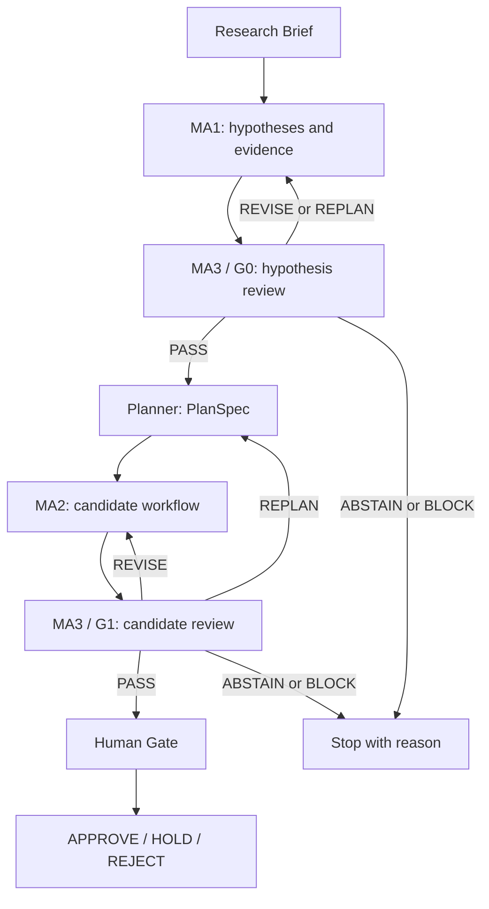
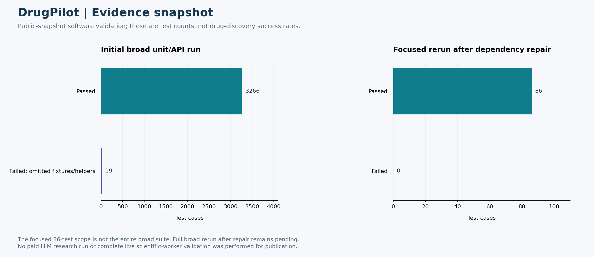

# DrugPilot

**가설 생성부터 후보 탐색·근거 감사·사람의 승인까지 연결하는 신약개발 연구 지원 웹앱**

> An evidence-governed multi-agent virtual laboratory for research hypotheses and drug-candidate workflows.

DrugPilot은 연구 질문을 구조화된 실행 계획으로 바꾸고, 가설과 후보에 연결된 근거를 단계별로 검토하는 연구 프로토타입이다. 에이전트가 만든 문장만 반환하는 대신, 사용한 데이터 소스·도구·판정·실행 상태를 저장해 연구자가 결과를 추적할 수 있게 구성했다.

| 항목 | 내용 |
|---|---|
| 사용 목적 | 신약개발 가설 및 후보 탐색 과정의 실행·검토 지원 |
| 주요 구성 | MA1, Planner, MA2, MA3, Orchestrator, Human Gate |
| 기술 스택 | Python, FastAPI, LangGraph, Pydantic, SQLite, 브라우저 UI |
| 실행 형태 | 로컬 웹앱; 별도 설정을 통한 외부 LLM·공개 데이터·과학 도구 연동 |
| 공개 기본 설정 | 명시적으로 표시되는 fixture 기반 데모 |

## 1. 해결하려는 문제

연구 가설, 문헌 근거, 약물 후보, 계산 결과가 서로 다른 도구에 흩어지면 결과의 출처와 처리 경로를 재구성하기 어렵다. LLM이 작성한 설명이 실제 도구 출력에 대응하는지, 특정 표적이나 assay 조건에 맞는 근거인지도 별도로 확인해야 한다.

DrugPilot은 다음 정보를 같은 실행 기록 안에 연결한다.

- 연구목표·질환·세포 유형·작용 방향·후보 수 등의 입력 제약
- 가설을 지지하거나 반박하는 출처와 표적 식별 정보
- 실행할 도구·경로·예산·중단 조건을 담은 계획
- 후보의 근거, 도구 계산 상태, 감사 결과와 재작업 이력
- 연구자가 최종적으로 승인·보류·거절한 결정

## 2. 전체 실행 구조



Orchestrator는 각 에이전트의 과학적 판단을 대신 작성하지 않는다. 실행 순서, 허용 도구, 호출 예산, 재시도, artifact 저장과 다음 상태를 관리한다. Human Gate에 도달하면 검토 가능한 상태를 저장하고 해당 그래프 실행을 종료한다. 연구자의 결정은 이후 별도 요청으로 기록한다. [실제 코드 흐름](docs/EXECUTION_FLOW_KO.md)

## 3. 구성 요소별 책임

| 구성 요소 | 입력과 출력 | 주요 책임 |
|---|---|---|
| Research Brief | 자유문 연구목표 → 검증된 구조화 입력 | 질환·표적 문맥·금지 조건·예산 등을 명시 |
| MA1 | 연구 질문·근거 → 가설 포트폴리오 | 표적과 가설을 구성하고 출처와 연결 |
| MA3 / G0 | 가설·근거 → 판정과 보완 사항 | 가설의 추적성, 적용 가능성, 제약 충족 여부 검사 |
| Planner | 승인 가설 → PlanSpec | 도구·경로·예산·정지 조건을 실행 계획으로 고정 |
| MA2 | PlanSpec → 후보와 도구 결과 | 승인 표적별 재창출 또는 de novo 경로 처리 |
| MA3 / G1 | 후보·trace → 판정과 보완 사항 | 후보 근거와 실행 과정의 일치 여부 검사 |
| Human Gate | 실행 snapshot → 연구자 결정 | 승인·보류·거절 및 후속 검토 기록 |

재창출과 de novo는 지원하는 두 경로이며, 모든 요청에서 두 경로가 동시에 실행된다는 의미는 아니다. 실제 경로 선택과 실행 가능 여부는 가설·계획·도구 준비 상태에 따른다.

## 4. 판정과 오류 처리

| 상태 | 의미 | 후속 처리 |
|---|---|---|
| `PASS` | 해당 단계의 진행 조건 충족 | 다음 단계로 이동 |
| `REVISE` | 현재 산출물 보완 필요 | 관련 단계 선택 재실행 |
| `REPLAN` | 실행 계획 또는 가설 구성 변경 필요 | 적절한 앞 단계부터 재계획 |
| `ABSTAIN` | 근거 부족이나 실행 제약으로 결론 보류 | 사유를 남기고 사람 검토 |
| `BLOCK` | 정책·출처·제약 위반으로 진행 불가 | 실행 차단 |

오류가 발생했다고 무조건 전체 작업을 처음부터 반복하지 않는다. 실패 단계와 영향을 받는 산출물을 기준으로 재실행 범위를 정하고, 재사용 가능한 artifact는 유지한다. 실사용 경로에서는 출처나 계산 결과가 없을 때 이를 synthetic 값으로 몰래 채우지 않는다.

## 5. 근거와 계산 도구의 구분

문헌·표적·화합물 정보 조회와 실제 계산은 다른 기능이다. PubMed, Europe PMC, Open Targets, UniProt, ChEMBL 등에서 레코드를 얻었다는 사실만으로 도킹·ADMET가 실행되거나 후보의 효능이 검증된 것은 아니다.

| 기능 | 공개본에서 확인할 부분 |
|---|---|
| 근거 검색·정규화 | 출처 식별, 표적 및 문맥 연결, 누락 상태 처리 |
| 후보 탐색 | 재창출·de novo 경로, 후보 identity와 근거 연결 |
| 도킹·수용체 준비 | 외부 worker, 도구 경로, 적합한 receptor profile 등의 별도 준비 필요 |
| 감사·판정 | Deterministic 검사와 선택적 LLM 검토의 역할 분리 |
| 평가 | 실행 입력과 평가 label을 분리하는 benchmark 관련 코드 |

자세한 범위는 [과학 도구 연동](docs/MA2_LIVE_SCIENTIFIC_TOOLCHAIN.md), [수용체 준비](docs/OFFLINE_RECEPTOR_CANDIDATE_BUILDER.md), [평가 체계](docs/EVALUATION_FRAMEWORK_KO.md)를 참고한다.

## 6. 상태 저장과 웹 인터페이스

브라우저가 연구 요청을 보내면 API는 실행 ID와 초기 snapshot을 반환한다. 긴 작업은 백그라운드에서 진행되며, UI는 이벤트 스트림과 상태 조회를 통해 갱신된다. SQLite에는 실행 상태와 검토 결과가 저장되고, artifact 및 trace를 통해 결과가 어느 단계에서 생성되었는지 확인할 수 있다.

대표 코드 위치는 다음과 같다.

| 위치 | 역할 |
|---|---|
| [src/drugpilot/agents/](src/drugpilot/agents/) | MA1·MA2·MA3 및 세부 근거 처리 |
| [src/drugpilot/orchestration/](src/drugpilot/orchestration/) | 상태 그래프와 실행 제어 |
| [src/drugpilot/domain/](src/drugpilot/domain/) | 입력·계획·후보·판정 스키마 |
| [src/drugpilot/api/](src/drugpilot/api/) | 웹 API와 요청 검증 |
| [src/drugpilot/tools/](src/drugpilot/tools/) | 외부 데이터 및 과학 도구 어댑터 |
| [src/drugpilot/web/](src/drugpilot/web/) | 대시보드 template과 브라우저 코드 |
| [tests/](tests/) | 에이전트·정책·인증·API 회귀 테스트 |

## 7. 로컬 데모 실행

**Python 3.11 또는 3.12**를 사용한다.

```bash
git clone https://github.com/CHOMINWOO1/DrugPilot.git
cd DrugPilot
python -m venv .venv
```

가상환경 활성화 후 패키지를 설치한다.

```bash
python -m pip install -e ".[test]"
```

Windows PowerShell에서는 `Copy-Item .env.example .env`, macOS/Linux에서는 `cp .env.example .env`로 로컬 설정을 만든다. 기본 공개 예시는 fixture 데모이며, 다음 명령으로 설정을 확인하고 서버를 실행한다.

```bash
drugpilot doctor
drugpilot serve --host 127.0.0.1 --port 8000
```

브라우저에서 `http://127.0.0.1:8000`에 접속한다. 이 주소는 사용자 PC의 loopback 주소다. 실제 서비스 IP나 계정 정보는 공개하지 않았다.

데모에서 생성되는 fixture 후보와 점수는 UI·상태 전이 검증용이다. 실제 연구 결과로 해석하면 안 된다. LLM mode, MA2 backend, 공개 근거 조회 설정은 독립적이므로 실제 연구를 실행할 때 각각을 확인해야 한다.

## 8. 실제 도구 연동 시 필요한 설정

실제 LLM 호출에는 로컬 환경변수나 `.env`의 provider credential이 필요하다. 과학 계산에는 별도 worker·실행파일·도구별 의존성이 필요하며, token·호출 횟수·비용 상한도 설정해야 한다. `.env.example`에는 빈 키와 예시 설정만 담겨 있다.

민감정보를 브라우저 입력이나 코드에 직접 넣지 않는다. 실사용 경로에서는 fixture fallback을 비활성화하고, 도구 또는 근거가 없는 경우의 실패·보류 상태를 유지한다. 공개 코드 업로드는 기존 내부 서비스의 배포나 설정 변경을 의미하지 않는다.

## 9. 검증 결과

```bash
python -m pytest tests/unit/test_beta_access_guard.py tests/integration/test_source_api.py -q
```

공개 준비 과정의 넓은 단위 테스트 실행에서는 누락된 예제·보조 코드 의존성을 확인했다. 이를 복구한 뒤 관련 모듈, 인증, 비밀정보 노출 방지, 멱등성 테스트 **86개가 통과**했으며 실제 Git에 담긴 파일만 추출한 별도 디렉터리에서도 같은 범위를 통과했다. 전체 범위와 재검증 과정은 [VALIDATION.md](VALIDATION.md)에 기록했다.

유료 LLM 연구 실행과 전체 과학 worker 검증을 이번 공개 과정에서 수행한 것은 아니다. `doctor` 검사는 provider key 없이 mock 구성을 확인했다.

## 10. 프로젝트의 범위

이 저장소는 에이전트 간 책임 분리, 근거와 주장 연결, 상태 기반 오류 처리, 실행 추적성과 사람 검토를 구현한 연구 지원 시스템이다. 임상 효능·안전성을 검증한 제품은 아니다. 실제 서비스 DB, 유료 실행 이력, 모델 키, 제3자 과학 도구의 실행파일은 공개본에 포함하지 않는다.


## 시각화된 결과와 진행 상태



[상세 결과·진행 상태·보완 과제·보안 범위](docs/portfolio-results/README.md)에서 근거 자료와 재현 코드를 확인할 수 있다.

## 공개 범위와 추가 문서

이 저장소는 원래 작업 폴더에서 핵심 코드·테스트·설정·작은 예제·대표 결과를 선별한 공개본이다. 대용량 데이터·가중치, 인증정보, 내부 실행 기록과 중복 문서 생성 산출물은 제외했다. 기존 논문·실험 수치는 기록된 결과이며 이번 README 개정에서 재측정하지 않았다.

- [실행한 검증과 한계](VALIDATION.md)
- [공개본 구성과 재사용 조건](PUBLICATION_NOTES.md)
- [인증정보와 로컬 설정 관리](SECURITY.md)

초기 공개본에는 별도 오픈소스 재사용 라이선스를 부여하지 않았다. 제3자 모델·데이터·의존성은 각 원 출처의 이용 조건을 따른다.
