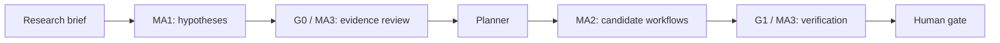

# DrugPilot

**An evidence-governed multi-agent virtual laboratory for research hypotheses and drug-candidate workflows.**

가설 생성, 연구 계획, 후보 탐색, 근거 검토와 사람의 승인을 연결한 신약개발 연구 지원 웹 애플리케이션입니다.



## Main capabilities

- Structured research briefs, constraints, hypotheses, and execution plans.
- Literature/biological evidence retrieval with source-bound claims and explicit unavailable states.
- Drug repurposing and candidate-generation routes, with optional external scientific tools.
- Deterministic audit gates, bounded LLM usage, selective retries, and human review.
- FastAPI dashboard, SQLite persistence, artifact provenance, and execution traces.
- Access-control, secret-redaction, API, and agent regression tests.

## Local quick start

Python **3.11 or 3.12** is required.

```bash
python -m venv .venv
# Activate .venv using your operating system's command.
python -m pip install -e ".[test]"
# Copy .env.example to .env, then configure only the mode you intend to use.
drugpilot doctor
drugpilot serve --host 127.0.0.1 --port 8000
```

Open `http://127.0.0.1:8000`. The public example configuration uses an explicitly labelled, offline fixture demo. Fixture candidates and scores demonstrate the workflow; they are not experimental drug-discovery results.

For real research execution, explicitly configure live mode, provider credentials, public data access, scientific workers, and budgets. Live source/tool failures must remain failures or abstentions; they must not be silently replaced with fixtures. API keys belong only in a local `.env` or environment variables.

## Tests

```bash
python -m pytest tests/unit/test_beta_access_guard.py tests/integration/test_source_api.py -q
```

See [validation](VALIDATION.md) for the test scope actually run for this snapshot. Optional chemistry and scientific-worker tests require additional dependencies.

## Explore

- [Execution flow](docs/EXECUTION_FLOW_KO.md)
- [Evaluation framework](docs/EVALUATION_FRAMEWORK_KO.md)
- [Scientific toolchain](docs/MA2_LIVE_SCIENTIFIC_TOOLCHAIN.md)
- `src/drugpilot/`: agents, domain models, orchestration, retrieval, API, and UI

## Scope

Research prototype; not evidence of experimental or clinical efficacy. The public repository contains application code and tests, not the internal service database, paid research histories, provider keys, or bundled third-party scientific executables. This source publication does not deploy or alter a running service.

## Publication and validation

This is a curated research source snapshot, not the complete local experiment archive.
See [validation](VALIDATION.md), [publication scope](PUBLICATION_NOTES.md), and [credential handling](SECURITY.md).
