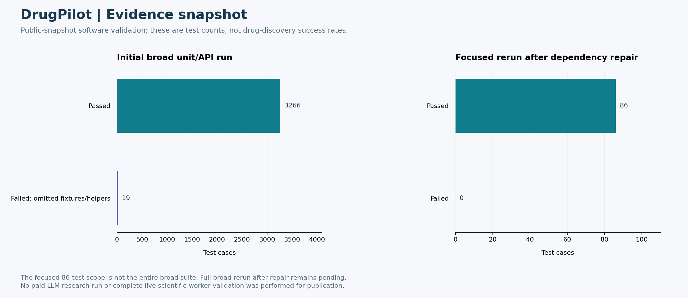

# DrugPilot: 실험 결과와 진행 상태

이 문서는 공개본에 보존된 실험·검증 기록을 시각화한 것이다. 원래 학습·과학 실험을 새로 수행했다는 의미는 아니다. 기능 테스트, 합성 데모, 실제 성능 지표를 서로 구분한다. 진행률의 임의 퍼센트는 사용하지 않는다.



## 결과 해석

초기 넓은 테스트에서는 3,266개 통과와 누락된 fixture·보조 코드로 인한 19개 실패가 있었다. 필요한 작은 파일을 복구한 뒤 관련 범위 86개가 모두 통과했다. 두 실행은 범위가 다르므로 통과율 상승이나 전체 회귀 테스트 완료로 표현하지 않는다.

## 현재 진행 상태

| 항목 | 확인된 상태 |
|---|---|
| 에이전트·웹 API·상태 저장 | 핵심 구현 공개 |
| 인증·비밀정보 노출 방지 등 | 복구 후 관련 범위 86개 테스트 통과 |
| 전체 넓은 테스트 재실행 | 복구 후 전체 범위는 미실행 |
| 실제 LLM·과학 도구 종단 간 평가 | 추가 검증 필요 |

## 다음 보완 과제

1. 수정 후 전체 unit/API 범위 재실행 및 결과 고정
2. 실제 도구 연결 조건과 fixture fallback 차단 확인
3. 고정 benchmark의 근거 정확성·감사 품질·호출 비용 측정

## 보안 범위와 남은 검증

공개 기본값은 mock/fixture이며 실제 서비스 DB·계정·키를 포함하지 않는다. 실서비스 적용 시 접근 제어, provider 전송 범위, 도구 권한과 실행 예산을 별도로 검증해야 한다.
`.gitignore` 외에 공개 파일 내용도 검사했다. 이전에 유출된 비밀정보를 ignore 규칙만으로 회수할 수는 없다.

## 근거와 그림 재현

- [VALIDATION.md](../../VALIDATION.md)
- [docs/EVALUATION_FRAMEWORK_KO.md](../../docs/EVALUATION_FRAMEWORK_KO.md)
- [그림의 수치와 조건](metrics.json)
- [확대 가능한 SVG](results.svg)
- [그림 재생성 코드](reproduce_figures.py)

```bash
python -m pip install matplotlib
python docs/portfolio-results/reproduce_figures.py
```

원시 실험 재현은 각 프로젝트의 본문 프로토콜을 따른다. 위 명령은 보존된 수치로 그림만 다시 만든다.
